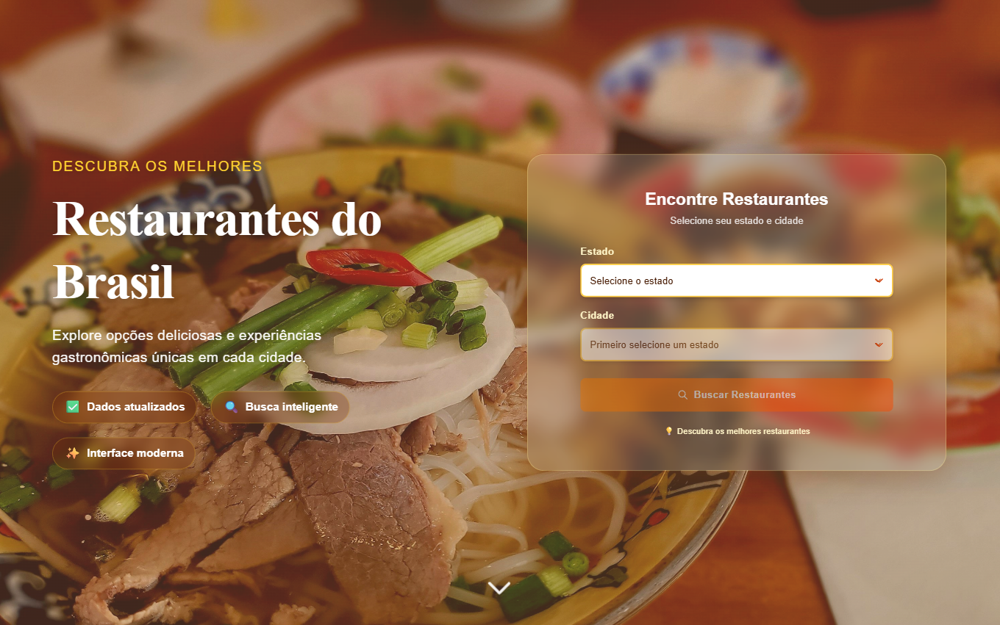
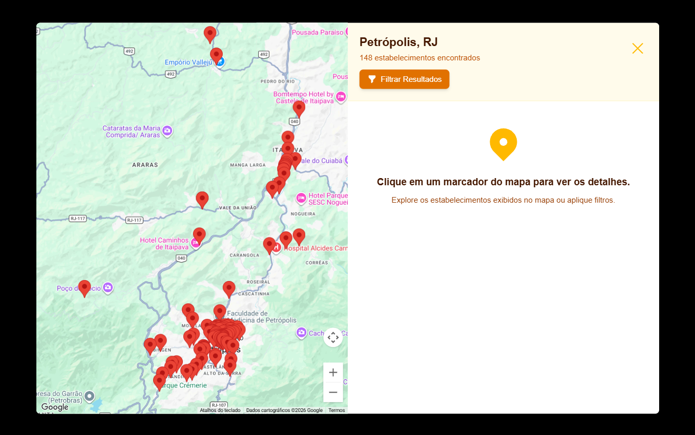
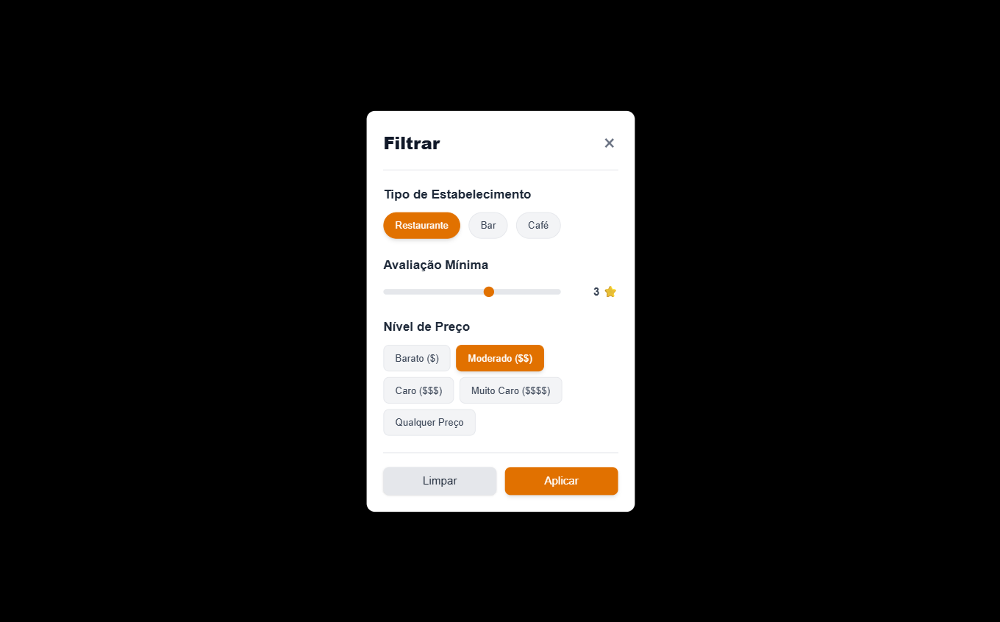
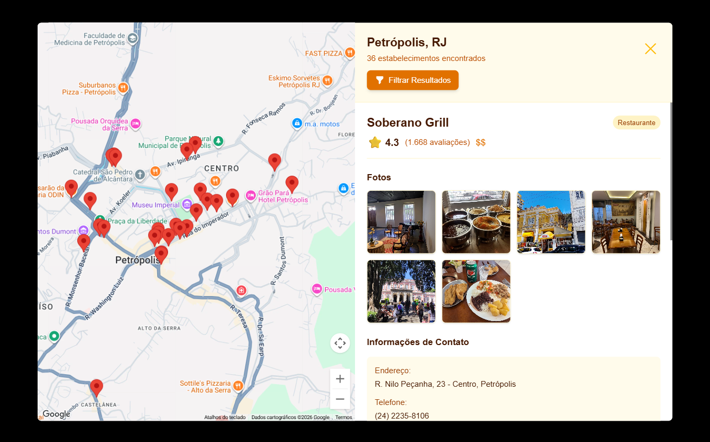
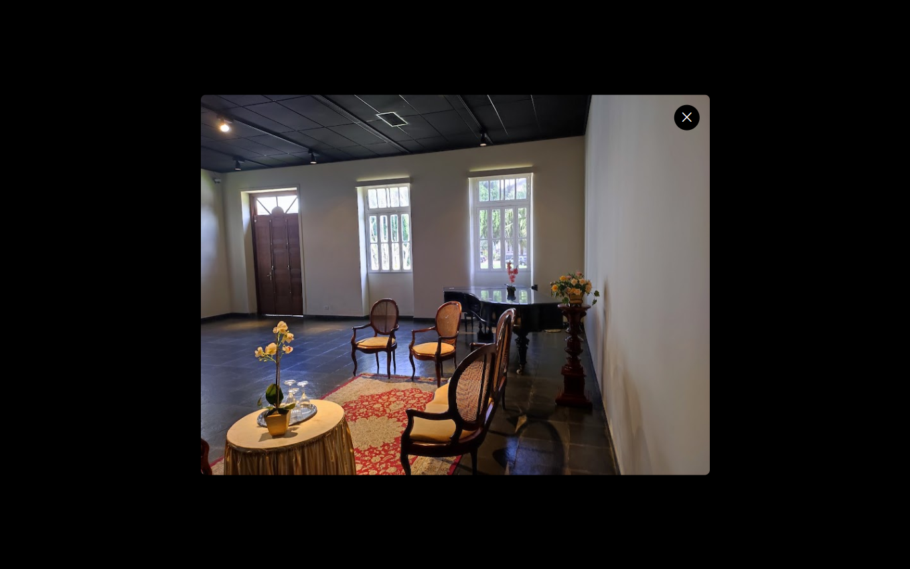
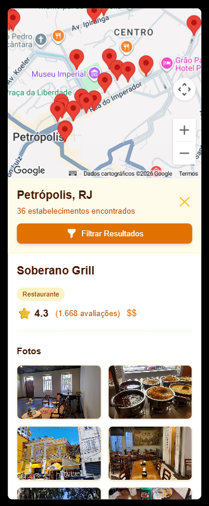

<div align="center">

# 📍 Restaurantes do Brasil

**Discover restaurants, bars and cafés in any Brazilian city on an interactive map, with filters and rich details powered by Google Places.**


[🌐 Live site](https://restaurantes-brasil.vercel.app/)

</div>



## ⚡ At a glance

- **Problem:** finding a good place to eat usually means juggling a map, reviews and filters in different tabs.
- **Solution:** one screen where you search a city, see every result on the map and refine by type, rating and price.
- **My role:** design, front-end development and the serverless API layer.

## ✨ Features

| Feature | What it does |
|---|---|
| 🔎 **Location search** | Find places in any Brazilian city and state |
| 🗺️ **Interactive map** | Every result is a clickable marker on a Google Map, linked to the results list |
| 🎛️ **Filters** | Type (restaurant, bar, café), minimum rating and price level ($ to $$$$) |
| 🪟 **Detail modal** | Address, photos, rating and review count, price level, open-now status, opening hours, phone, website, user reviews and cuisine types |
| 🖼️ **Photo gallery** | Browse photos of each place, when available |
| 📱 **Responsive design** | Layout adapted for desktop and mobile |

## 📸 Screens

| Map and results | Filters |
|---|---|
|  |  |

| Place details | Photo gallery |
|---|---|
|  |  |

| Mobile |
|---|
|  |

## 🏗️ Technical highlights

- **Next.js API Routes** act as a serverless backend between the app and the Google Places API, keeping the search and details logic out of the client. The server key has no `NEXT_PUBLIC_` prefix, so it is never exposed to the browser.
- **Google Maps JavaScript API** for the interactive map and markers, and **Google Places API** for geocoding, place search and place details.
- **Client-side filtering** by type, rating and price, so results update instantly without a new search.
- **Tailwind CSS** for a fast, responsive interface.

## 🛠️ Run locally

```bash
git clone https://github.com/larissabenvenuti/Restaurantes-Brasil.git
cd Restaurantes-Brasil
npm install
npm run dev
```

Create a `.env.local` file:

```env
NEXT_PUBLIC_GOOGLE_MAPS_API_KEY=your-api-key
MAPS_SERVER_API_KEY=your-api-key
```

- `NEXT_PUBLIC_GOOGLE_MAPS_API_KEY`: browser key, used by the interactive map.
- `MAPS_SERVER_API_KEY`: server key, used only by the API Routes to call the Places API.

<details>
<summary><b>How to get a Google API key</b></summary>

1. Open the [Google Cloud Console](https://console.cloud.google.com/) and create or select a project.
2. Enable billing for the project (Google requires it, but includes a free monthly usage credit).
3. Under **APIs & Services → Library**, enable **Maps JavaScript API** and **Places API**.
4. Go to **APIs & Services → Credentials → Create credentials → API key** and create **two keys**: one for the browser and one for the server.
5. Restrict each key to avoid misuse: the browser key by HTTP referrer (your domain and `localhost`) and by API (Maps JavaScript API); the server key by API (Places API).
6. Paste them into `.env.local`.

</details>

Open http://localhost:3000.

## 🔒 Copyright & license

**All rights reserved.**

The source code, design and all other elements in this repository belong exclusively to **Larissa Benvenuti**. Place data, photos and reviews are provided by Google and belong to their respective owners.

Reproduction, distribution, modification, public display or commercial use, in whole or in part, without the written permission of the rights holder is strictly prohibited.
